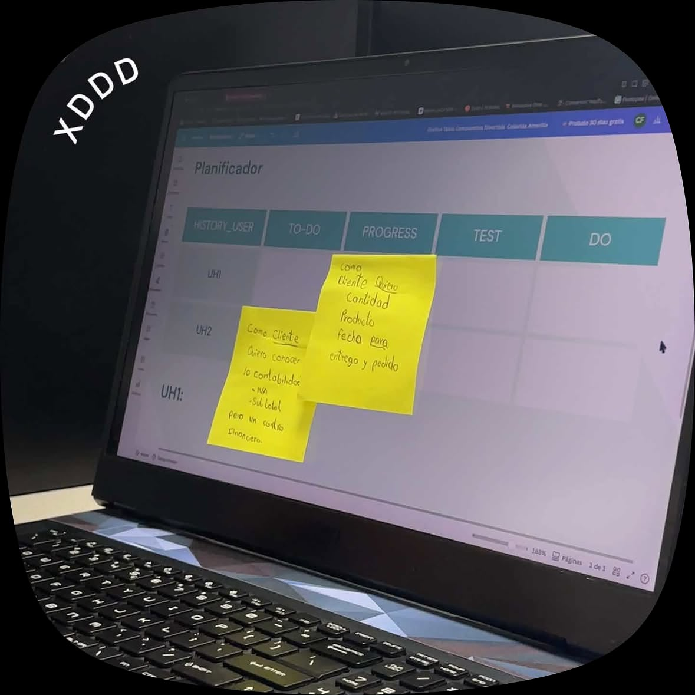
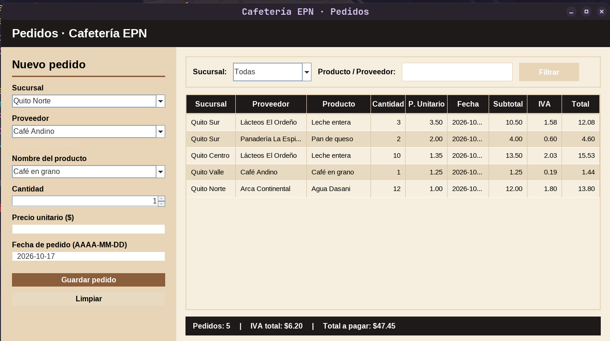

# Modulo de Pedidos

# *Integrnates: Lenin Amangandi, Alegria Farinangp, Erick Guerrero , Rommel*

## Historia de Usuario

## Caso 1

## Caso 1.1

## Caso entendido

El módulo de pedidos se encarga de gestionar las solicitudes de productos provenientes de las diferentes sucursales, tomando como referencia los productos registrados en el módulo de inventario. Cada pedido debe identificar la sucursal solicitante, el proveedor correspondiente y la fecha en la que se realiza la compra, además de registrar la cantidad y el precio unitario de los productos solicitados.

Asimismo, el módulo calculará automáticamente el subtotal de la compra, el valor del IVA y el total del pedido, permitiendo conocer el costo final de cada adquisición.

## Resultado: Interfaz del módulo de pedidos

